




<b>📄 Ler em modo texto</b>

 

Sou desenvolvedor **full stack com foco em back-end e segurança**. Crio aplicações web com **Next.js, Node.js e Laravel**, com atenção a autenticação, controle de acesso por perfil e boas práticas de segurança (**OWASP**).

- 🚀 Co-fundador da **[RDL Development](https://rdldevelopment.dev)**, com o Robson e o Luiz
- 🎯 No ar: **[Simula SISU 2026](https://simula-sisu.vercel.app/)**
- 🔐 Autenticação, JWT, controle de acesso e APIs seguras

 



 


<a href="https://simula-sisu.vercel.app/">
  
</a>

<b>🎮 Detalhes da fase 1 — Simula SISU 2026</b>

 

> **Já disponível!** Simulador de notas de corte do SISU: o estudante informa as notas do ENEM, escolhe a modalidade de vaga e vê as chances reais de aprovação em cada curso, com os pesos oficiais de cada universidade.

* 🎯 Nota ponderada por curso com os pesos oficiais e comparação com as notas de corte do Sisu.
* 📌 Cursos fixados e comparador lado a lado (corte, folga, turno, vagas, avaliação do MEC).
* 🐦 **Seriema:** assistente com IA que tira dúvidas do aluno sobre o Sisu.
* 🐳 Monorepo full stack: Next.js, API Express + Prisma e PostgreSQL no Docker.

Feito pela **RDL Development** (Robson, Daniel e Luiz).

  <a href="https://rdldevelopment.dev"></a>
  <a href="https://github.com/dansmaciell/MindHealth"></a>

 



 


 


  <a href="https://www.linkedin.com/in/daniel-maciel-892656287/"></a>
  <a href="https://rdldevelopment.dev"></a>
  <a href="https://github.com/dansmaciell"></a>

